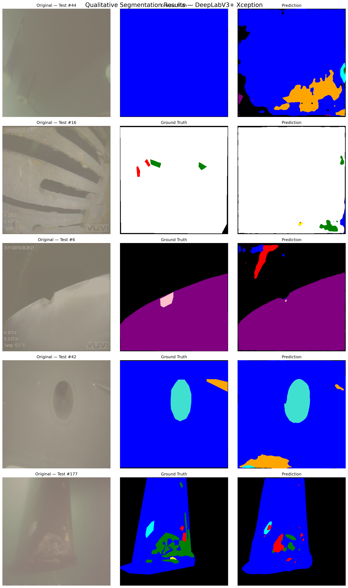
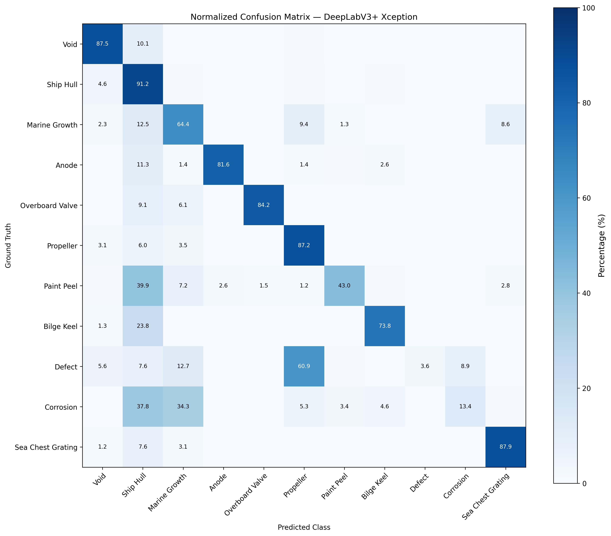
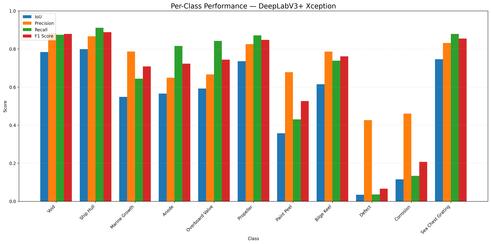
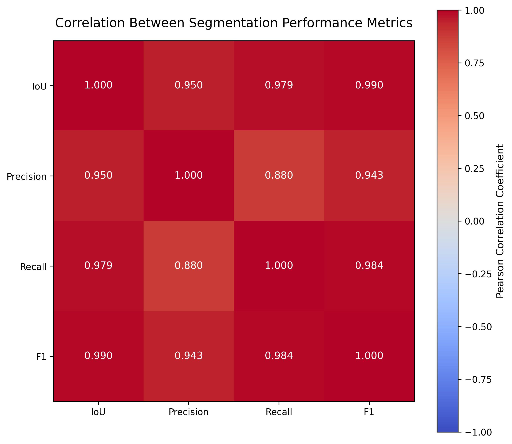

# Underwater Ship Hull Inspection — Semantic Segmentation

Multi-class semantic segmentation of underwater ship-hull inspection images using **DeepLabV3+ with an Xception backbone**, trained on the LIACi dataset.

## Project Overview

This project segments underwater inspection images into 11 semantic classes, covering ship structures, marine growth, corrosion, paint peeling, and other surface conditions.

## Architecture

- Model: DeepLabV3+
- Backbone: Xception
- Pretrained backbone: ImageNet
- Output stride: 8
- ASPP dilation rates: 12, 24, 36
- Input resolution: 512 × 512
- Output classes: 11

## Dataset

**LIACi — Large-scale Image Annotation for Underwater Inspection**

Dataset: https://liaci.sintef.cloud/

Classes:
1. Void
2. Ship Hull
3. Marine Growth
4. Anode
5. Overboard Valve
6. Propeller
7. Paint Peel
8. Bilge Keel
9. Defect
10. Corrosion
11. Sea Chest Grating

## Training Configuration

| Parameter | Value |
|---|---|
| Framework | PyTorch |
| Optimizer | AdamW |
| Initial learning rate | 0.0001 |
| Loss function | Cross-Entropy |
| Batch size | 4 |
| Epochs | 50 |
| Scheduler | ReduceLROnPlateau |
| Hardware | NVIDIA Tesla T4 |
| Best checkpoint | Epoch 38 |

## Final Test Results

Evaluated on 191 held-out test images.

| Metric | Result |
|---|---|
| Pixel Accuracy | 85.08% |
| Mean IoU | 53.59% |
| Mean Precision | 71.46% |
| Mean Recall | 65.25% |
| Mean F1 | 65.52% |
| Test Loss | 0.6832 |

Model selection was based on validation mIoU (best: 55.08%).

## Visual Results

### Qualitative Segmentation

### Normalized Confusion Matrix

### Per-Class Performance

### Metric Correlation

## Implementation

The complete experiment notebook is available at:

[DeepLabV3+ Xception Notebook](notebooks/DeepLabV3Plus_Xception_LIACi.ipynb)

The implementation follows the DeepLabV3+ architecture and uses the VainF implementation as an architectural reference:

https://github.com/VainF/DeepLabV3Plus-Pytorch

## Limitations

The model performs better on large structural regions than on difficult surface-condition classes. Defect and corrosion segmentation remain challenging.

## Future Work

- Class-imbalance-aware loss functions
- Improved augmentation strategies
- Further experiments to improve minority-class IoU
- Comparison with alternative segmentation architectures

## Notes

The dataset and trained checkpoint are not included in this repository.
    